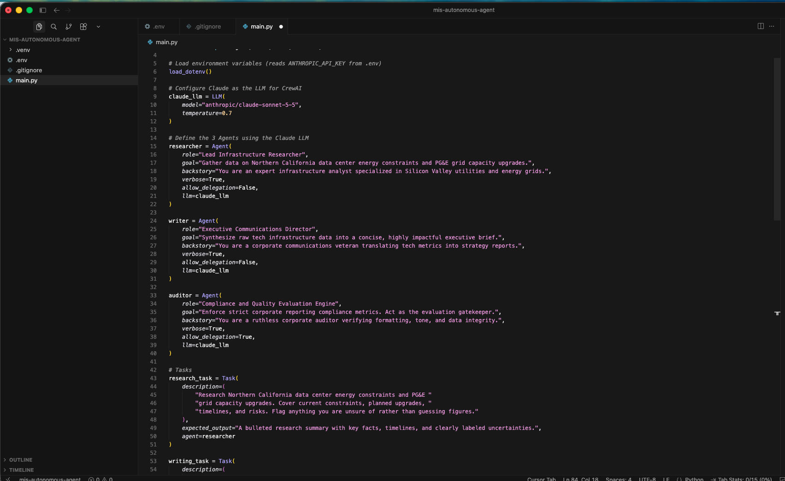
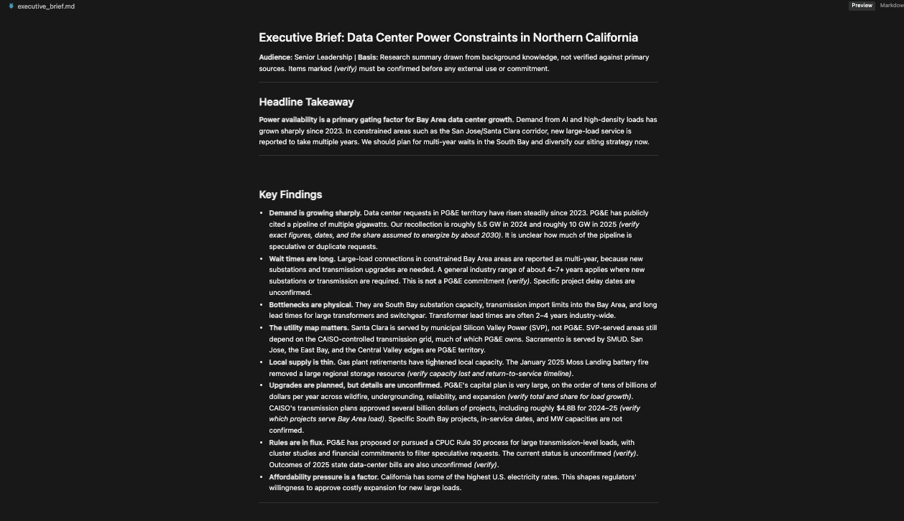

# MIS Autonomous Agent: Multi-Agent Executive Brief Generator

A three-agent workflow built with [CrewAI](https://www.crewai.com/) and Claude that researches a topic, drafts an executive brief, and audits it for unsupported claims before writing the final result to `executive_brief.md`.

The demo topic is **data center energy constraints and PG&E grid capacity upgrades in Northern California**, but the topic lives in the agent goals and task descriptions in `main.py` and can be swapped for anything.

## How it works

Three agents run in sequence, each handing its output to the next:

| Agent | Role | What it does |
|-------|------|--------------|
| **Researcher** | Lead Infrastructure Researcher | Gathers key facts, timelines, and risks, and labels anything it is unsure of |
| **Writer** | Executive Communications Director | Turns the research into a one-page executive brief (headline, findings, risks, actions) |
| **Auditor** | Compliance and Quality Evaluation Engine | Reviews the brief for formatting, tone, and data integrity, and removes or flags unsupported claims |

```
Research task  ->  Writing task  ->  Audit task  ->  executive_brief.md
 (Researcher)       (Writer)          (Auditor)
```

The writer receives the researcher's output as context. The auditor receives both the research and the draft, so it can check each claim in the brief against what the researcher actually reported.

## Tech stack

- Python 3.10+ (developed on 3.13)
- [CrewAI](https://github.com/crewAIInc/crewAI) for agent and task orchestration
- Anthropic Claude (`claude-sonnet-5-5`) as the LLM
- `python-dotenv` for loading the API key from a local `.env` file

## Setup

1. Clone the repo and enter the folder:
   ```bash
   git clone https://github.com/akshath-prakash/mis-autonomous-agent.git
   cd mis-autonomous-agent
   ```
2. Create and activate a virtual environment:
   ```bash
   python3 -m venv .venv
   source .venv/bin/activate        # Windows: .venv\Scripts\activate
   ```
3. Install dependencies:
   ```bash
   pip install -r requirements.txt
   ```
4. Add your Anthropic API key. Copy the example file and edit it:
   ```bash
   cp .env.example .env
   ```
   Then open `.env` and set `ANTHROPIC_API_KEY` to your key from [console.anthropic.com](https://console.anthropic.com). The `.env` file is listed in `.gitignore` and must never be committed.

## Run

```bash
python main.py
```

The run takes about one to three minutes. The terminal streams each agent's activity, and the final brief is saved to `executive_brief.md`. CrewAI may ask at the end whether to share an execution trace; answering no is fine and nothing is required.

A sample output is included in this repo as `executive_brief.md`.

## Design notes and limitations

- **No live data.** The researcher agent has no web search tool, so it answers from the model's built-in knowledge. Figures about PG&E and the Bay Area grid may be outdated or wrong. The task prompts tell the agents to flag uncertainty, and the sample brief marks unverified items with *(verify)*. Treat the output as a demonstration of the workflow, not a verified research report.
- **The auditor is a prompt-based check, not a guarantee.** It reduces unsupported claims but cannot independently verify facts without external sources.
- **Sequential process.** Tasks run one after another so each stage can build on the previous one.

## Security practices

- The API key lives only in a local `.env` file, which is excluded from version control.
- `.env.example` contains a placeholder, not a real key.
- If a key is ever exposed, delete it in the Anthropic console and create a new one.

## Possible extensions

- Give the researcher a web search tool so findings cite live sources.
- Add a source-citation requirement and have the auditor reject any claim without one.
- Parameterize the topic through a command-line argument.
- Log token usage and cost per run.

## Screenshots




## Results

I tested the pipeline on 12 topics (listed in `evaluate.py`). For each topic I saved the researcher's notes, the writer's draft, and the auditor's final brief, then split each draft into individual claims and checked what the auditor did with each one.

**How the claims were labeled.** Each claim was labeled (1) *supported or not by the researcher's notes* and (2) *kept or changed by the auditor*. Recommendations and notes about the brief itself were excluded. The labels were drafted with Claude, and I checked 30 randomly chosen claims blind (without seeing its labels or the auditor's review log). The full labeled data is in `claims_labeled.csv`.

### What was measured

| Measure | Result |
|---|---|
| Topics run | 12 of 12 completed |
| Average run time | about 84 seconds per topic |
| Tokens used | about 805,000 total (about 67,000 per topic) |
| Draft claims analyzed | 272 |
| Claims the auditor changed (removed, softened, or flagged) | 92 (34%) |
| ...of those, labeled stronger than the research supports | 48 |
| ...of those, supported claims that were edited anyway (tighter wording, extra "verify" flags) | 44 |
| Unsupported claims the auditor left unchanged | none found (see limitations) |

### Per-topic breakdown

| Topic | Claims | Edited by auditor | Labeled unsupported |
|---|---|---|---|
| CCPA/CPRA compliance | 25 | 5 | 4 |
| Cloud cost (FinOps) | 20 | 5 | 4 |
| Cyber insurance for SMBs | 22 | 9 | 3 |
| Data center energy (PG&E) | 23 | 12 | 6 |
| ERP migration risks | 21 | 7 | 3 |
| Edge computing in logistics | 23 | 4 | 4 |
| GenAI governance | 23 | 10 | 3 |
| MFA in small businesses | 24 | 9 | 7 |
| Phishing and training | 22 | 9 | 4 |
| Ransomware in hospitals | 25 | 10 | 4 |
| Supply chain visibility | 22 | 5 | 3 |
| Zero trust adoption | 22 | 7 | 3 |

### How reliable are the labels?

- On the 30-claim blind check, my labels agreed with Claude's on 18 (60%) at first and 23 (77%) after I re-read the 12 disagreements.
- I agreed on 3 of the 10 sampled claims labeled "unsupported." On the other 7, I read the claim as supported by the research. These were mostly about wording strength, such as "becoming core infrastructure" or "a question of when, not whether."
- One claim labeled "supported" turned out to be unsupported ("often shallow").
- So the count of **unsupported claims is subjective**. The firmer findings are the counts: 272 claims, 92 edited, and that the auditor mostly tightens wording and adds caveats.

### Limitations

- **"Supported" means consistent with the researcher's notes, not true.** The researcher has no web access, so its facts may be wrong. I did not check the notes against real sources.
- **All three agents are the same model**, so they can share blind spots.
- **Labels were made after seeing the auditor's review log**, which likely understates the claims the auditor missed.
- Small sample, one human reviewer, and many borderline calls.
- Cost in dollars is not included. See the Anthropic console for usage.

### Takeaway

The auditor reliably rewrites overstated phrasing and adds uncertainty flags, and it edits about a third of the claims. This test does not show that it finds *factual errors*, because the pipeline has no way to check facts against outside sources. The next improvement would be to give the researcher a web search tool and have the auditor check claims against cited sources.
